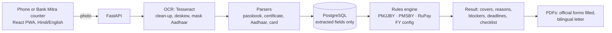

<p align="center">
  
</p>

<h1 align="center">Haq</h1>

<p align="center">
  <b>Find the government insurance a family has already paid for, and prepare the claim.</b><br/>
  Hack With Delhi 4.0 · Track 1: Fintech and Financial Inclusion · Team Two Brain Cells
</p>

<p align="center">
  <a href="https://haq-nu.vercel.app">Live app</a> ·
  <a href="https://drive.google.com/file/d/1veXKKRRLhhbZLaE20WfcRD21dtCPmzu4/view?usp=sharing">Demo video</a> ·
  <a href="https://haq-api-rwbu.onrender.com/docs">API docs</a> ·
  <a href="https://docs.google.com/presentation/d/1RTC8TVyl6Sr7NbrZ8uBc9caVWTykA7qL/edit?usp=sharing">Pitch deck</a> ·
</p>

---

## The problem

Crores of low-income Indians hold three government insurance covers through their
savings account, often without knowing it:

| Scheme | Cover | Cost | How it is paid |
|---|---|---|---|
| PMJJBY (life) | ₹2 lakh on death from any cause | ₹436 a year | Auto-debited from the account |
| PMSBY (accident) | ₹2 lakh on accidental death or total disability | ₹20 a year | Auto-debited from the account |
| RuPay PMJDY card (accident) | ₹1–2 lakh on accidental death | Free | Valid only if the card was used in the 90 days before |

No policy document reaches the family. The only trace is a line in the passbook:
`PMJJBY PREMIUM 436.00`. When the account holder dies, the family often does not know a
claim exists, which documents it needs, or that deadlines are running. Cumulative
enrolments stood at **27.84 crore (PMJJBY)** and **58.78 crore (PMSBY)** by July 2026
(PIB). Settlement ratios count only the claims that were filed, so claims never filed are
invisible in the official numbers.

## What Haq does

A Bank Mitra (a banking correspondent who already serves these families) or a family
member photographs the passbook. Haq:

1. **Reads the passbook as the policy document.** It finds premium debits and card use,
   and works out which covers were in force on the day of the event.
2. **Adds up every cover.** An accidental death can mean PMJJBY + PMSBY + RuPay, up to
   ₹6 lakh, which the family would not know to ask for together.
3. **Checks eligibility with written rules, not AI.** The 30-day waiting period for new
   PMJJBY members, the RuPay 90-day card-use window, accident-only covers, age limits.
   Every result comes with its reason and the passbook line it rests on.
4. **Catches rejections before filing.** A name spelled differently on the death
   certificate, a missing FIR or post-mortem report, no registered nominee. It shows
   them on day one instead of after the branch returns the file.
5. **Prepares the paperwork.** It fills in the official PMJJBY, PMSBY and RuPay 2026-27
   claim forms, adds a bilingual checklist, counts down each deadline, and writes an
   escalation letter in Hindi and English if the claim stalls.

**Protect mode** helps living users: *your PMJJBY cover has lapsed*, *your RuPay cover
ends in 12 days: use the card once*, *no nominee is registered*.

Haq estimates what to verify; it does not approve claims. The bank and the insurer still
verify every claim.

## Try it in two minutes

No login is needed for the family flow.

1. Open the [live app](https://haq-nu.vercel.app). The first load can take up to a minute while the
   free server wakes up.
2. Go to **[/demo](https://haq-nu.vercel.app/demo)** and pick a scenario:

   | Scenario | Story | What you should see |
   |---|---|---|
   | **Sunita** | Husband died in a road accident; she thinks there is no insurance | **₹6,00,000** across three covers, a name-mismatch blocker, missing FIR and post-mortem report |
   | **Meena** | Natural death 20 days after joining PMJJBY | ₹0, with the waiting-period rule explained, not a silent rejection |
   | **Raju** | Living user checks his own cover | PMJJBY lapsed, RuPay cover ending in 12 days, no nominee |

3. On the result screen, press **Read Out Results** (परिणाम बोलकर सुनाएँ) to hear it,
   then continue to the documents checklist and the claim forms screen to download the
   filled official claim form and the escalation letter.

**Upload your own run:** start a new claim from the home page and upload the synthetic
sample photos from [`client/public/samples/`](client/public/samples/), for example
`sunita_passbook.png`, `sunita_death_certificate.png` and `sunita_rupay_card.png`. Real
OCR reads them on the server. All sample people, accounts and numbers are invented.

**Bank Mitra view:** `/operator/login` with `mitra@haq.demo`. {{DEMO_PASSWORD_NOTE}}

## Features

| | |
|---|---|
| **Passbook OCR** | Tesseract reads passbooks, death certificates, Aadhaar and RuPay cards. It tolerates phone photos: tilted, unevenly lit, with common misreads like `O`/`0` |
| **Rules engine** | Pure, tested Python. Scheme amounts, waiting periods and card windows live in one yearly config file, `fy2026_27.yaml` |
| **Cross-document checks** | Names compared across Hindi and English documents; dates of birth, accounts and nominee checked |
| **Official forms** | The government PMJJBY and PMSBY claim-cum-discharge forms and the 2026-27 RuPay form, filled in, plus Haq's bilingual checklist pages |
| **Deadlines** | A countdown for each scheme's claim window |
| **Hindi first** | Every screen in Hindi and English, voice input and read-aloud in the browser |
| **Two ways in** | Families get no account: a case code plus a 4-digit PIN resume the case on any phone. Bank Mitras log in and see the cases they created |
| **Privacy** | Aadhaar and card numbers are masked before anything is stored or logged. Uploaded images are discarded after reading; only the extracted fields are kept |
| **Free to run** | Open-source OCR, no paid APIs. Runs on free tiers |

## How it works



- **Why rules and not an LLM decides eligibility:** a family's ₹2 lakh should not depend
  on a probabilistic answer. Every decision is a pure function of the case facts,
  traceable to a passbook line and a rule, and covered by tests.
- **Why the passbook:** it is the one record every enrolled family has. Premium debits
  prove enrolment; card transactions prove RuPay eligibility.
- **Two OCR passes:** Tesseract's Hindi model misreads the digit 1 as the Devanagari
  danda (।), which breaks dates and amounts. Haq reads in English first and falls back to
  Hindi + English only when the English pass is incomplete.

| Layer | Choice |
|---|---|
| Client | React 19, TypeScript (strict), Vite, Tailwind, TanStack Query, react-i18next, PWA |
| API | FastAPI, Pydantic v2; the TypeScript client types are generated from its OpenAPI spec |
| Data | PostgreSQL (Neon), SQLAlchemy 2 async, Alembic |
| Documents | Tesseract + OpenCV, PyMuPDF (forms and Hindi PDFs), rapidfuzz |
| Hosting | Render (API, Docker), Vercel (client), Neon (database) |

## Testing

- **Server:** 220 automated tests: every rule, flag and alert code; the three scenarios;
  Postgres persistence and access control; extraction parsers; form filling.
- **OCR:** 6 tests that run real Tesseract on the sample photos (in CI and Docker).
- **Client:** lint, strict type-check, tests and a production build in CI.

These show the logic is correct on known inputs. They do not yet measure OCR accuracy
across real banks' passbook layouts, or outcomes for real families; see the limits below.

## Limits

- Haq **indicates possible cover**. Enrolment, card status and the payout are confirmed
  by the bank and the insurer.
- The parsers are tuned on synthetic passbooks. Each bank's layout will need testing with
  real photos.
- Scheme values follow the FY 2026-27 circulars. A new year means a new config file and,
  for RuPay, a new form.
- The case data is personal. Before a pilot with real families we need agreed consent,
  retention and deletion rules.

## Roadmap

1. A pilot with five Bank Mitras: do families leave one visit knowing what to verify
   and what to bring back?
2. More passbook layouts from more banks.
3. A Hindi voice agent that walks a family through the claim, one question at a time.
4. **Reverse claims:** match death registrations against enrolments so the state reaches
   the family first. (Concept only.)

## Team: Two Brain Cells

| Name | Role |
|---|---|
| **Tijil Minocha** (lead) | Backend: API, rules engine, OCR, official forms, deployment |
| **Piyush Patel** | Frontend: app screens, Hindi-first UX, voice, PWA |
| **Shriyansh Gupta** | Backend : Database, persistence, testing |
| **Shubham Gupta** | Frontend & Content Writeup |

## Repository

```
client/   React PWA (screens in src/features, API client generated from the server)
server/   FastAPI app: api → services → domain (pure rules) ; infra (db, OCR, PDF)
docs/     proposal, engineering plan, deployment guide, frontend handoff
```

Run it locally: see [docs/development.md](docs/development.md). Deploy it: see
[docs/deploy.md](docs/deploy.md).

## Sources

- PMJJBY and PMSBY enrolment figures: Press Information Bureau releases
  [2287200](https://www.pib.gov.in/PressReleasePage.aspx?PRID=2287200) and
  [2237489](https://www.pib.gov.in/PressReleasePage.aspx?PRID=2237489).
- Official claim forms and where each came from:
  [`server/app/infra/pdf/official/SOURCES.md`](server/app/infra/pdf/official/SOURCES.md).
- Scheme rules as configured: [`fy2026_27.yaml`](server/app/domain/config/fy2026_27.yaml).
